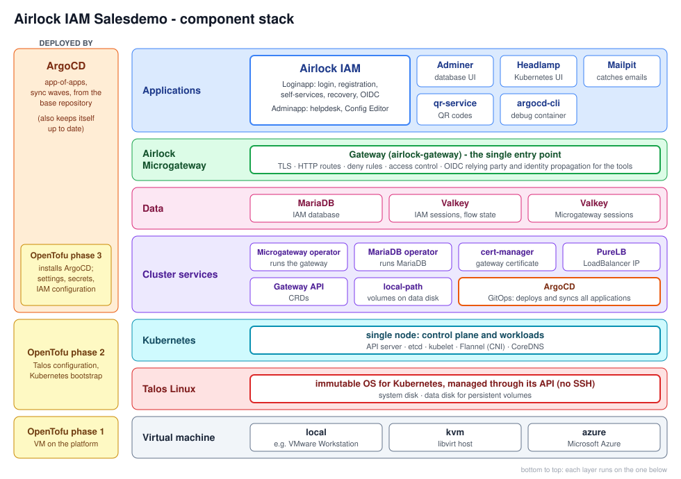
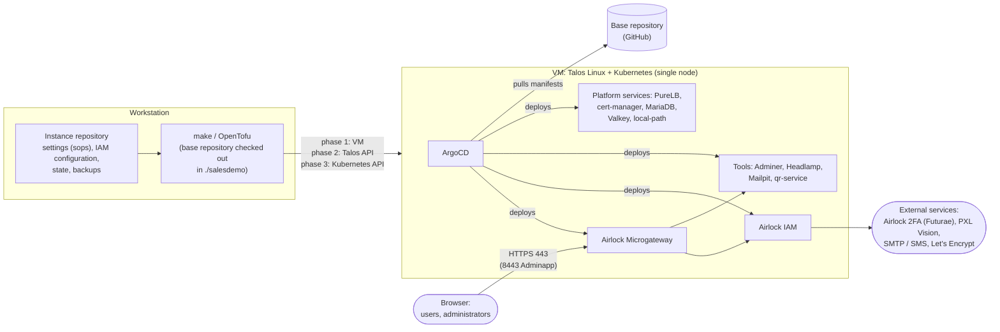
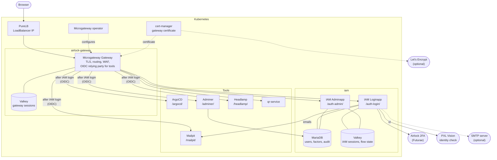
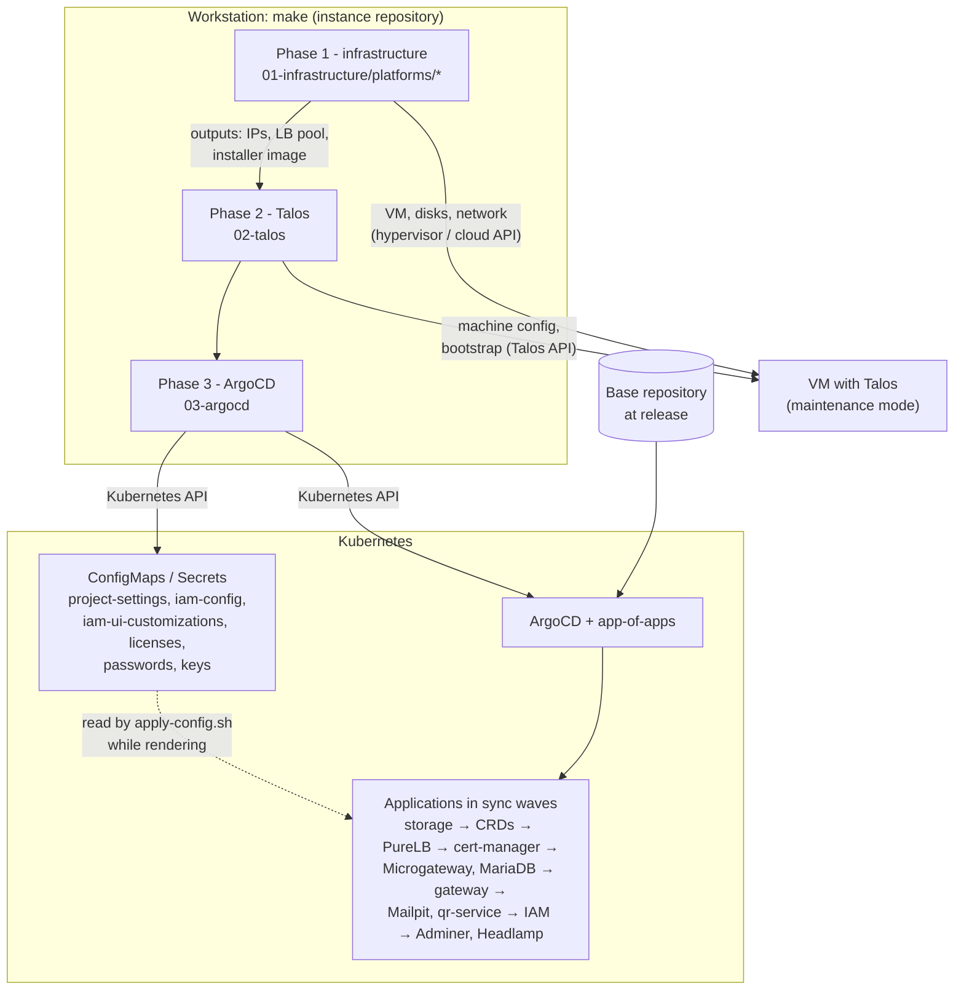
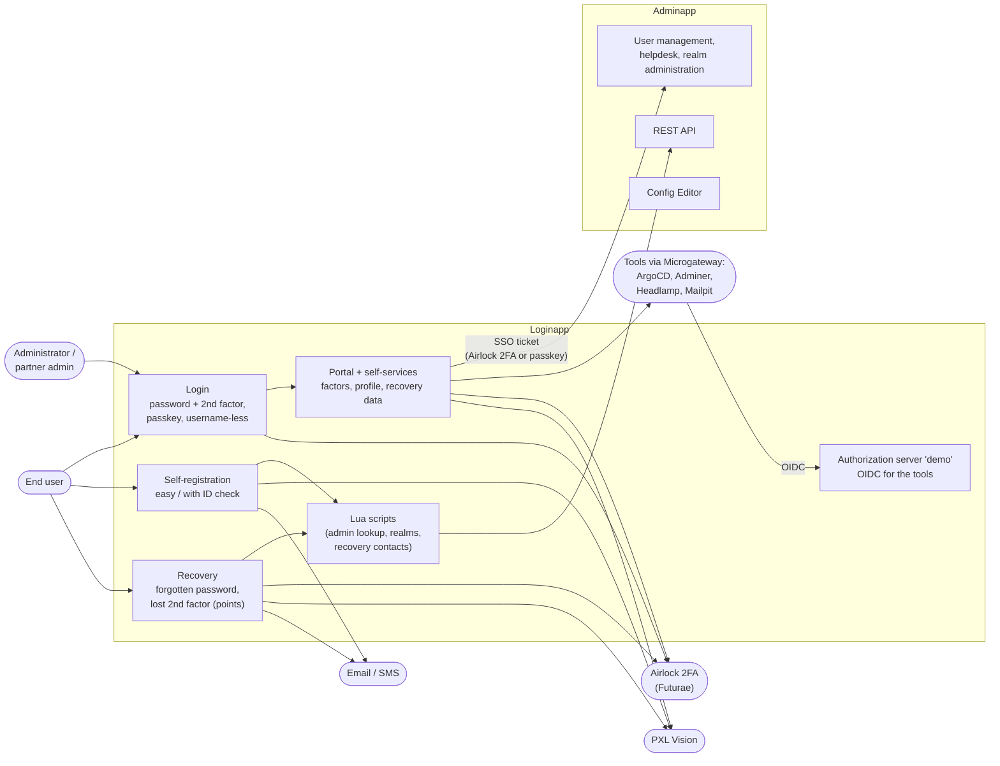
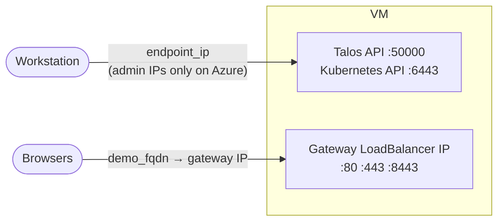

# Airlock IAM Salesdemo - architecture overview

An overview for integrators: which components make up a salesdemo instance, where they run and how they work together. Details are in the [internals](README.md) of this repository and in the [instance documentation](https://github.com/airlock-presales/airlock-iam-salesdemo-instance-template) (setup, settings, usage).

**In short:** one virtual machine runs Talos Linux with a single-node Kubernetes cluster. OpenTofu, started with `make` from the instance repository on a workstation, creates the VM, installs Kubernetes and ArgoCD, and hands over the instance's settings, secrets and IAM configuration. ArgoCD then deploys everything else from this (base) repository. Airlock Microgateway is the only way in: it routes to Airlock IAM and protects the administration tools, which use IAM for login.

## Overview

Two repositories:

| Repository | Content | Who changes it |
|---|---|---|
| **Base** (this one) | the installation: OpenTofu phases, Kubernetes manifests of all applications, IAM configuration template, design kit | maintained centrally, released with tags; instances pick a release (`release` file) |
| **Instance** (one per demo, from the [template](https://github.com/airlock-presales/airlock-iam-salesdemo-instance-template)) | settings (encrypted with sops/age), the instance's IAM configuration and texts, OpenTofu state, provider locks, database backups | the instance owner |

The instance repository never leaves the workstation's control: ArgoCD reads only the base repository. Instance-specific values reach the cluster through OpenTofu (ConfigMaps and Secrets, see [deployment](#deployment)).

## Runtime components

| Component | Role |
|---|---|
| **Airlock Microgateway** | Kubernetes Gateway API implementation and the single entry point: TLS termination (certificate from cert-manager or provided), HTTP routes to IAM and the tools, deny rules, access control. For the tools it is the OIDC relying party of IAM and propagates the identity (token exchange for ArgoCD, basic authentication for Mailpit, header for Adminer). Sessions in its own Valkey. The operator in `airlock-microgateway-system` turns the Gateway resources into the gateway deployment. |
| **Airlock IAM** | one container (StatefulSet `iam-0`) with Loginapp (login, registration, self-services, portal, recovery, OAuth 2.0 / OIDC authorization server for the tools) and Adminapp (helpdesk, user management, Config Editor). Init containers prepare the instance, copy the IAM configuration and texts and set up the database (schema, administrators, realm roles). |
| **MariaDB** | IAM database, run by the MariaDB operator, data on the local data disk. |
| **Valkey** (2×) | IAM state repository (sessions, flow state) and Microgateway session store - both in memory, no persistence. |
| **cert-manager** | cluster CA (`internal`) or Let's Encrypt (`letsencrypt`, HTTP-01 through the gateway) for the gateway certificate. |
| **PureLB** | gives the gateway's LoadBalancer Service an IP address from `lb_pool`. |
| **local-path-provisioner** | persistent volumes on the VM's second disk. |
| **ArgoCD** | deploys and keeps all applications in sync with the base repository (app-of-apps). |
| **Tools** | Adminer (database UI), Headlamp (Kubernetes UI), Mailpit (catches IAM's emails if no SMTP server is set), qr-service (QR codes for the PXL Vision check), argocd-cli (debug container). |

URLs and credentials: [usage](https://github.com/airlock-presales/airlock-iam-salesdemo-instance-template/blob/main/docs/usage.md).

## Deployment

- **Phase 1** creates the VM and its surroundings on the chosen platform and publishes a small [contract](../01-infrastructure/README.md) (IP addresses, LoadBalancer pool, ...) for the next phases.
- **Phase 2** configures Talos through its API, bootstraps Kubernetes and writes `output/kubeconfig.yaml` and `output/talosconfig.yaml` into the instance directory.
- **Phase 3** writes the settings, secrets (licenses, generated passwords and keys) and the IAM configuration into the cluster, installs ArgoCD and the app-of-apps.
- **ArgoCD** renders each application from the base repository. Per-instance values (FQDN, issuer, IP addresses, ...) come from the ConfigMap `argocd/project-settings`: each application's `apply-config.sh` fills them into placeholders. A hash of the settings makes ArgoCD render again after a change.
- **IAM configuration** is not in git as seen by ArgoCD: OpenTofu puts the instance's `iam/` (configuration, texts, design kit zip) into ConfigMaps; IAM restarts when they change and copies them into its instance at start.

The OpenTofu state is stored encrypted in the instance repository - with the age key, the instance repository is all that is needed to rebuild or remove the instance ([backup](https://github.com/airlock-presales/airlock-iam-salesdemo-instance-template/blob/main/docs/backup.md)).

## IAM functional view

- **Applications** (target of a login): `demo` (portal), `usernameless`, `recovery`, `adminapp-local` (Adminapp from the portal), tool applications (`argocd`, `adminer`, `headlamp`, `mailpit`), step-ups (`identity-step-up`, `config-restore-step-up`) and `adminapp` (partner administrator onboarding via an external OIDC provider, prepared but inactive). Administrator applications require Airlock 2FA or a passkey.
- **Administrators are users** in realms (`owners`, `partners`, `orphans`, `users-<company>`); realm roles and delegations define what they may do in the Adminapp. Partner administrators manage the users who named them at the self-registration.
- **Lua scripts** in the flows use the Adminapp REST API as technical administrator `selfreg-lookup` (lookup of the responsible administrator, partner realms, recovery contacts and confirmations).
- **Configuration**: one `iam-config.yaml` per instance, optional snippets for instance-specific features, server-side texts, and the design kit zip for the Loginapp UI (styling, UI texts in en/de/fr/it).

What can be demonstrated: [use cases](use-cases.md); flow details: [usage](https://github.com/airlock-presales/airlock-iam-salesdemo-instance-template/blob/main/docs/usage.md).

## Network and platforms

| | local (e.g. VMware Workstation) | kvm | azure |
|---|---|---|---|
| VM created by | you, boots the Talos ISO | OpenTofu on the KVM host (libvirt over ssh) | OpenTofu (resource group, VNet, NSG, storage, VM) |
| Talos | boots the ISO, installed to disk in phase 2 | boots the disk image, installer run in phase 2 (`/dev/vda`) | boots the disk image (no install) |
| Node / API address | fixed IP (DHCP reservation) | fixed IP (DHCP reservation) | public admin IP, NATed to the private NIC address |
| Gateway address | first address of `lb_pool` in the VM's subnet | first address of `lb_pool` | second private IP of the NIC (PureLB), NATed from a second public IP with DNS label |
| Name resolution of `demo_fqdn` | hosts file / local DNS | hosts file / DNS | public DNS (A or CNAME record) |
| Access restriction | network | network | NSG: Talos/Kubernetes API and 8443 only from `vm_admin_ips` |
| Certificate | `internal` (or `provided`) | `internal` (or `provided`) | `letsencrypt` recommended |

Port 8443 leads to the same Adminapp as `/auth-admin/` on 443, but only from `vm_admin_ips` (Microgateway access control policy). Platform requirements and steps: `docs/platform-<platform>.md` in the instance template; adding a platform: [01-infrastructure](../01-infrastructure/README.md).
